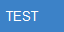

# 02 行内标记

> 用途:验证全部行内语法与"不该被解析"的边界。重点看 **2.6 / 2.7** 两节。

## 2\.1 九种基础标记

**粗体** · **下划线式粗体** · *斜体* · *斜体二* · ~~删除线~~ · `行内代码` · <u>下划线</u> · ==高亮== · x^2^ · H~2~O

**预期**:十项全部生效;保存重开后仍生效\(不会退化为字面语法)。

## 2\.2 嵌套组合

- **粗体里含 *斜体* 与 `代码`**
- ==高亮里含 **粗体** 与 `代码`==
- *斜体里含 <u>下划线</u> 与 ~~删除线~~*
- `代码里含 **粗体** —— 不应生效`

**预期**:前三项嵌套生效;第四项必须**整体按字面量**显示\(见 2.6)。

## 2\.3 链接与 wikilink

- 普通链接:[外部站点](https://example.com)
- 自动链接:[https://example.com/auto](https://example.com/auto)
- 裸链接:[https://example.com/bare](https://example.com/bare)
- 相对链接:[回到 01](./01-块级语法.md)
- wikilink:[[某篇笔记]] 与 [[某篇笔记|显示别名]]
- 危险协议\(必须被拒):\[点我\]\(javascript:alert\(1))

**预期**:前四种点击后用系统默认浏览器打开/wikilink 在编辑器内跳转;最后一项**不得**变成可点的 `javascript:` 链接\(应保持字面或被拒绝)。

## 2\.4 图片

行内图片\(应显示 64×32 蓝色小图):

独立成行的图片:

![[assets/测试图片.png|63|测试图片]]

故意不存在的图片\(应降级为破图占位,且编辑器不报错):

**预期**:第一、二张正常显示;第三张不导致崩溃;切主题/进出演示模式后仍正常。

## 2\.5 数学公式\(KaTeX)

- 行内:$E = mc^2$ · $\frac{a}{b}$ · $\sqrt{x^2 + y^2}$ · $\sum_{i=1}^{n} i$
- 块级:$$\int_0^1 x^2\,\mathrm{d}x = \frac{1}{3}$$
- 非法公式\(不应抛错):$\frac{1}{$

**已知限制**:`\$\$` 必须与公式**写在同一行**;跨行写法不解析\(编辑器与 AI 气泡一致)。

## 2\.6 行内代码里的内容必须保持字面量\(重点)

`**不是粗体**` · `*不是斜体*` · `~~不是删除线~~` · `==不是高亮==` · `^不是上标^` · `$不是公式$` · `<u>不是下划线</u>`

`a\_b\_c` · `arr\[0\]` · `if \(x) \< y` · `a|b` · `obj.method\()`

`C:\\Users\\me` · `\\server\\share` · `\\d+\\s\*` · `.`

**预期**:

1. 第一行八项**全部按字面量**显示,不得出现粗体/斜体/删除线/高亮/上标/公式/下划线;
2. 第二行不被解析成斜体/链接/表格分隔;
3. 第三行:**反斜杠后跟字母、数字的内容\(Windows 路径、正则)必须原样保留**;反斜杠后跟标点的历史转义\(如 `.`)会被还原为 `.`\(与升级前渲染一致)。

## 2\.7 转义字符\(代码之外)

\*不是斜体\* · \_不是斜体\_ · # 不是标题 · > 不是引用 · 1. 不是有序列表 · - 不是列表 · \[不是链接\] · \`不是代码\`

**预期**:全部显示为字面字符;**保存 → 重开后仍是字面量**\(不得"复活"成语法)。

## 2\.8 白名单原始 HTML

<b>b 粗体</b> · <strong>strong</strong> · <u>u 下划线</u> · <mark>mark 高亮</mark> · 上标下标 · <kbd>Ctrl</kbd>+<kbd>Shift</kbd>+<kbd>K</kbd> · 红色 span · <abbr title="HyperText Markup Language">HTML</abbr> · 
居中文本

**预期**:白名单标签与 `style` 生效。

**不该生效的**\(必须退化为可见字面文本,不得执行):\ · \<iframe src="[https://example.com"](https://example.com")>\</iframe> · \ ·  · <a>js 链接</a>

## 2\.9 特殊字符与 Unicode

- 中文 · English · 日本語 · 한국어 · Русский
- emoji:🦈 🎉 ✅ ❌ ⚠️ ❤️
- 数学符号:≤ ≥ ≠ ± × ÷ ∞ ∑ √ ∈
- 引号与标点:"双引号" '单引号' 「角引号」 \(括号) 【方括号】
- 全角标点:,。\!?:;
- 组合字符:é ü ñ ç · 带变音符号的拼音:ā á ǎ à
- 零宽与特殊空白\(应正常显示,不错位):A B\(含不间断空格)

**预期**:均正常渲染;保存往返后不变成乱码或问号。