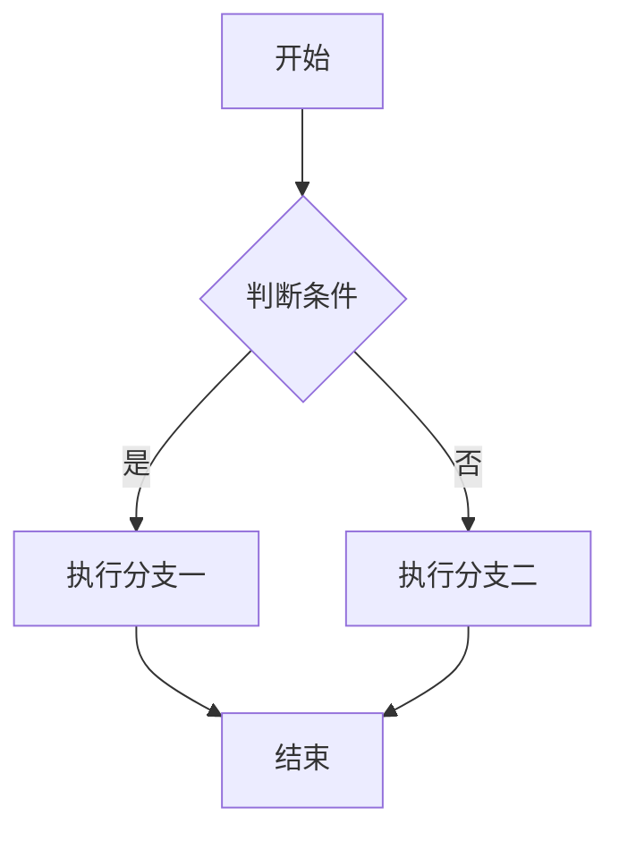
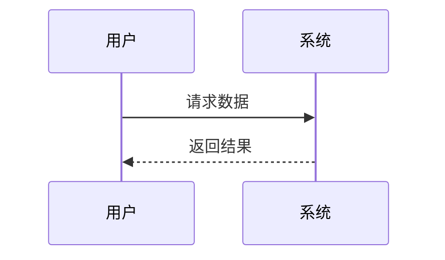
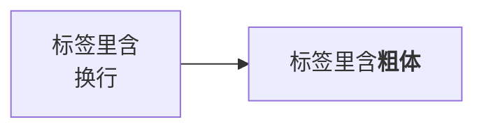

# 03 表格与代码块

> 用途:表格、代码块、Mermaid、图片路径。**3.3 节是保存往返的回归重点,请勿删除。**

## 3\.1 基础表格与对齐

| 左对齐 | 居中 | 右对齐 |
| :--- | :---: | ---: |
| 普通文本 | 中文内容 | 123 |
| **粗体** | `行内代码` | $x^2$ |
| [链接](https://example.com) | ==高亮== | ~~删除线~~ |
|  | 空单元格测试 |  |

**预期**:三种对齐生效;空单元格不导致表格错位。

## 3\.2 单列表格与长内容表格

| 单列 |
| :--- |
| 只有一列 |
| 这一格的内容很长,用来测试窄窗口下的换行与横向滚动行为,内容继续拉长以触发溢出。 |

| 名称 | 说明 | 备注 |
| :--- | :--- | :--- |
| UniDoc | 以 Markdown 为核心的编辑器 | 本地优先 |
| KaTeX | 数学公式渲染 | 已内建 |
| Mermaid | 图表渲染 | 已内建 |

## 3\.3 保存往返回归重点\(勿删)

> 本节的每一行都对应一个**已修复的往返膨胀缺陷**。验证方法见 [04-往返稳定性回归.md](./04-往返稳定性回归.md)。

| 场景 | 单元格内容 | 修复前的症状 |
| :--- | :--- | :--- |
| 括号 | Tauri v2 \\(Rust) | 每次保存反斜杠翻倍\\(指数) |
| 公式 | $\\frac{1}{2}$ 与 $\\sum_{i=1}^{n} i$ | 公式源码被反斜杠破坏,KaTeX 渲染失败 |
| 代码含反斜杠 | `a\\\\b` 与 `C:\\\\Users\\\\me` | 反斜杠被逐轮翻倍 |
| 代码含管道符 | `a\|b` | 转义层级错乱 |
| 纯文本管道符 | a\|b | 同上 |
| 行内代码含语法 | `**不是粗体**` 与 `arr\\[0\\]` | 代码内容被转义污染 |
| 多反斜杠 | `\\\\server\\\\share` 与 `\\\\d+\\\\s\\*` | 反斜杠膨胀 |

**预期**:上表所有单元格渲染正确;**多次"保存 → 重开"后文件字符数不再增长**\(详见 04 的验证步骤)。

## 3\.4 代码块

```ts
// TypeScript:含行内语法字符,不应被当作 Markdown 解析
const re = /\d+\s*/g
const path = 'C:\\Users\\me'
const bold = '**不是粗体**'
const arr = [1, 2, 3].map((x) => x * 2)
interface Foo<T> { bar: T }
```

```json
{
  "name": "unidoc",
  "features": ["markdown", "katex", "mermaid"],
  "stars": 1234
}
```

```bash
# shell:注释、管道、重定向
grep -rn "关键词" ./src | head -20 > out.txt
echo $HOME && ls -la
```

```python
def fib(n: int) -> int:
    a, b = 0, 1
    for _ in range(n):
        a, b = b, a + b
    return a
```

```plaintext
无语言围栏:第一次保存后会被补成 plaintext,属一次性归一化。
内容里的 ** 与 --- 与 | 都应按字面量保留。
```

```text
含 Markdown 结构字符的文本块:
# 不是标题
- 不是列表
| 不是表格 |
**不是粗体**
```

**预期**:各语言标签正确显示\(高亮未实现);围栏内内容**一律不解析**;、`---`、`|`、`#` 均按字面量保存。

## 3\.5 Mermaid 图表







```mermaid
graph TD
  X[这是非法图?] --> Y[[[语法错误
```

**预期**:三张正常图渲染为 SVG;标签内的 <br/>、`\<b>` 生效;最后一张语法错误时**降级为源码 + 错误提示**,不得导致编辑器崩溃;切换深浅主题后图表跟随重绘。

## 3\.6 图片路径的三种形态

- vault 相对路径\(相对本文档所在目录):
- 不存在路径\(应破图占位):
- 网络图片\(需要联网,失败时破图占位):

**预期**:相对路径能正确解析为可加载地址\(桌面端走 asset 协议);后两张不导致报错。

  